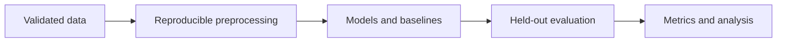
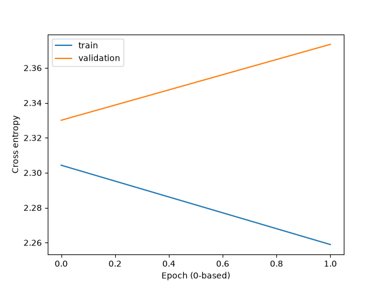
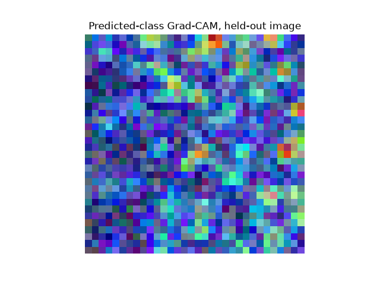

# CNNs and transfer learning: a controlled CIFAR-10 pipeline

A reproducible PyTorch training/evaluation system for a small CNN and ResNet18, including explicit pretrained-weight provenance, augmentation, checkpoint selection, Grad-CAM and a checkpoint-backed Streamlit demo.

## Research question and methodology
Official CIFAR-10 train/test boundaries are preserved. A seeded permutation partitions training data into train and validation subsets; the test loader uses official test data only. CPU mode uses a bounded training subset; full mode uses 40,000 training rows, 10,000 validation rows and 50 epochs. AdamW, ReduceLROnPlateau and validation-loss early stopping select checkpoints. Four comparisons: custom/no augmentation, custom/augmentation, pretrained frozen ResNet18 and pretrained fine-tuned ResNet18. ImageNet weights use 224px inputs and ImageNet normalization; custom CNN uses 32px CIFAR normalization. These differing representations and pretraining must be disclosed. Frozen backbone BatchNorm statistics remain fixed.



## Executed results
Executed two seeded CPU synthetic runs (with and without augmentation), 100 training images, 20 validation, 20 test, 2 epochs. Non-augmented loss 2.2971; accuracy 0.200, training time 0.185s. These are **not CIFAR-10 results**. Actual JSON files include per-class metrics, latency, parameters, failure positions and full configuration.




## Reproduce
From this repository root:
```bash
python -m pip install -e '.[dev]'
python -m vision_study.cli --data data --limit 1000 --epochs 2
python -m vision_study.cli --data data --limit 1000 --epochs 2 --augment --output results/augmented
python -m vision_study.cli --kind resnet18 --pretrained --freeze --limit 1000 --epochs 2 --output results/frozen
python -m vision_study.cli --kind resnet18 --pretrained --limit 1000 --epochs 2 --output results/finetune
# Offline software test:
python -m vision_study.cli --synthetic --limit 100 --epochs 2 --output results/synthetic-no-augmentation
streamlit run src/vision_study/app.py
pytest -q
ruff check .
ruff format --check .
```

## Implementation and review
`src/` contains the package and CLI; `tests/` contains CPU-safe unit and integration checks; `configs/` records defaults; `results/` stores measured metrics, not large datasets or checkpoints. See [methodology](docs/methodology.md), [reproducibility](docs/reproducibility.md), [status](docs/IMPLEMENTATION_STATUS.md), [quality review](docs/QUALITY_REVIEW.md) and [limitations](docs/limitations.md).

Four tests passed: architecture outputs, Grad-CAM finite maps, invalid transfer flags, disjoint train/validation IDs, seeded repeated-run equality, checkpoint reload, end-to-end metric/figure outputs and CLI help. Initial Streamlit page checked with a real synthetic-trained checkpoint.

## Limitations and future work
Official CIFAR-10 download failed with proxy tunnel 403 at www.cs.toronto.edu. No real-data CIFAR-10 or pretrained transfer comparison has executed. Synthetic images have independent random labels: accuracy is a software diagnostic, not scientific recognition performance. Pretrained weights must download successfully; no silent random-weight fallback. No GPU benchmark, confidence calibration or full hyperparameter search. Upload browser interaction remains untested. Grad-CAM is a qualitative diagnostic, not causal explanation.

## References and licensing
Krizhevsky (2009), *Learning Multiple Layers of Features from Tiny Images*, University of Toronto technical report; [CIFAR dataset](https://www.cs.toronto.edu/~kriz/cifar.html). He et al. (2016), *Deep Residual Learning for Image Recognition*, CVPR, DOI 10.1109/CVPR.2016.90. Selvaraju et al. (2017), *Grad-CAM*, ICCV, DOI 10.1109/ICCV.2017.74. torchvision ResNet18 weights metadata and CIFAR10 dataset documentation. Dataset and weights not redistributed.

Repository code: MIT; third-party data, pretrained weights and libraries retain their own terms. No affiliations, publications or independent authorship claims are made.


Additional verified check: official torchvision ImageNet ResNet18 weights downloaded successfully from download.pytorch.org. A frozen-backbone one-epoch training/evaluation/Grad-CAM/checkpoint run completed on 20 synthetic training images; see results/pretrained-transfer-smoke/metrics.json. This validates the transfer execution path, not CIFAR-10 accuracy. The custom two-run synthetic experiment and all real CIFAR-10 limitations above remain unchanged.
